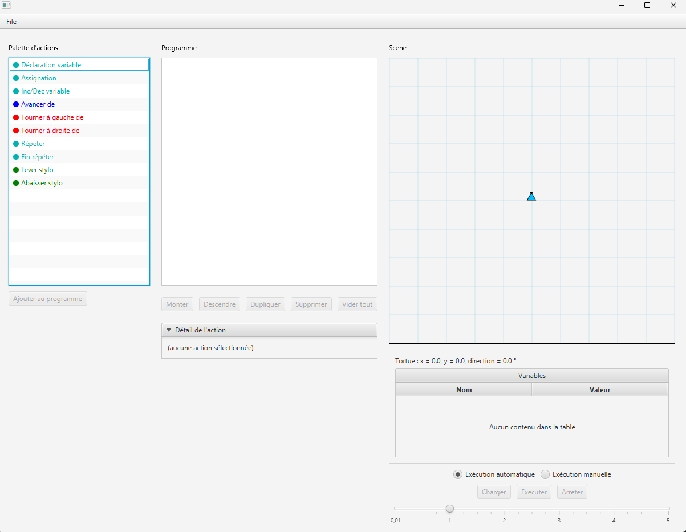
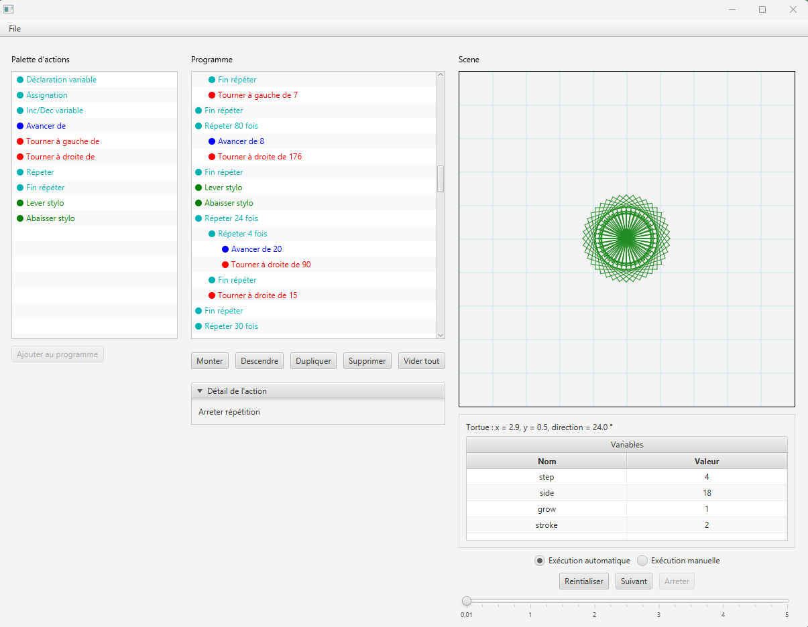

# Scratch-like

Scratch-like is a desktop application inspired by Scratch, developed in Java as part of a group project during my Bachelor's degree in Application Development at EPFC (Brussels).

The goal was to build a simplified programming environment where users can create and execute sequences of instructions, including commands for drawing.

## Technologies

- **Language:** Java 21
- **Interface:** JavaFX 21
- **Build tool:** Maven
- **Libraries:** ControlsFX
- **Testing:** JUnit 5

## Features

- Creation and execution of simple programs
- Drawing through programmed instructions
- Execution of a complete program with an optional delay between instructions
- Loading programs from files
- Object-oriented design, with UML documentation included in the project

## Screenshots

### Main Interface

### Program Example

## Installation

To run the project locally:

1. Clone the repository:
   `git clone https://github.com/Jonavdb/Scratch-like.git`
2. Open the project in a Java IDE that supports Maven and JavaFX.
3. Make sure Java 21 is installed and configured.
4. Let Maven download the required dependencies.
5. Run the application's main class from your IDE.

## Project Team

This project was developed by three EPFC students:

- Jonathan Vanderbiest
- Ali Haboula
- Emmanuel Yangni-Angaté

## Author

**Jonathan Vanderbiest**

Bachelor's student in Application Development at EPFC, Brussels.

Currently looking for a development internship starting in February 2027.
